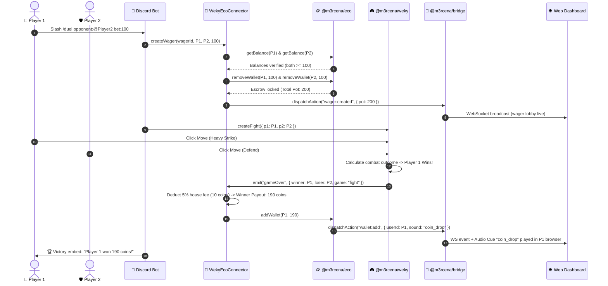
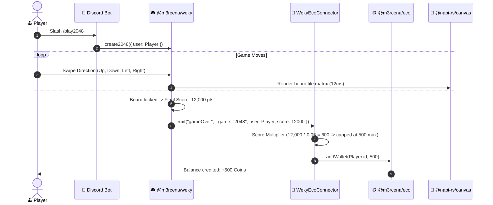
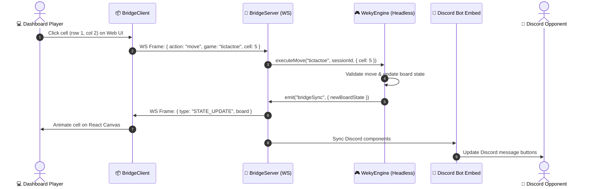

# 🏛️ M3rcena Ecosystem Architecture & Integration Master Guide

> **Packages**: [`@m3rcena/weky`](https://github.com/M3rcena/m3rcena-weky) • [`@m3rcena/eco`](https://github.com/M3rcena/m3rcena-eco) • [`@m3rcena/bridge`](https://github.com/M3rcena/m3rcena-bridge)  
> **Version**: `v14.28.0`  
> **License**: Apache-2.0  
> **Node.js**: `>= 22.0.0` (Native `node:sqlite` support, ESM & CJS dual build)

---

## 🗺️ 1. High-Level Ecosystem Topology

The diagram below illustrates the complete architecture of all 3 packages, how they connect with Discord, each other, the database layer, and external web dashboards:

```mermaid
flowchart TB
    subgraph Discord["💬 Discord Platform"]
        SlashCmd["Slash Commands / Message Commands"]
        Buttons["Discord Components V2 (Buttons / Menus)"]
        ChatChannel["Text & Voice Channels"]
    end

    subgraph BotCore["🤖 Discord.js Bot Application"]
        DJSClient["Discord.js Client"]
        BotConfig["Unified Config & Handlers"]
    end

    subgraph WekyPkg["🎮 @m3rcena/weky (Arcade & Minigames Engine)"]
        WekyMgr["WekyManager"]
        Minigames17["17 Minigames (2048, Fight, Snake, RPS, TicTacToe...)"]
        ArcadeHub["ArcadeHub (Centralized Menu Launcher)"]
        TournEngine["TournamentManager (4-16 Player Brackets)"]
        AI_Bosses["Minimax AI & RPG Dungeon Bosses"]
        Leaderboards["LeaderboardManager (FIDE ELO & Scores)"]
        WekyAudio["SoundboardManager (Discord Voice & Dashboard MP3s)"]
        HeadlessEngines["Headless Engines (Game Logic Decoupled from Canvas)"]
        WekyCanvas["@napi-rs/canvas Renderers (15ms Rust Rendering)"]
    end

    subgraph EcoPkg["🪙 @m3rcena/eco (Ultimate Economy & Progression Engine)"]
        EcoMgr["EcoManager"]
        BankSys["BankManager (Wallet, Bank, Net Worth)"]
        VaultSys["VaultManager (Vault Tiers 1-5, Compound Interest)"]
        LoanSys["LoanManager (FICO Credit Scores 300-850, Debt)"]
        TaxSys["TaxManager (Municipal Utility Bills, Wealth Taxes)"]
        CareerSys["CareerManager (Employment Ladder & Shifts)"]
        ShopSys["ShopManager (Inventory, Buffs & Consumables)"]
        BusinessSys["BusinessManager (Passive Businesses, Employees)"]
        CasinoSys["CasinoManager (Blackjack, Slots, Roulette, Crash)"]
        StockSys["StockMarketManager (Live Stock & Crypto Market)"]
        HeistSys["HeistManager (Multiplayer Syndicate Bank Heists)"]
        PetSys["PetManager (Pets, Hunger, Expeditions)"]
        CrateSys["CrateManager (Mystery Loot Crates)"]
        EcoCanvas["Holographic Debit Card & Market Chart Renderers"]
    end

    subgraph ConnectorLayer["🔗 Cross-Package Connector"]
        Connector["WekyEcoConnector / EcoWekyConnector"]
        PvpWagers["PvP Bet Pots (Atomic Escrow & Payouts)"]
        StreakBonus["Win Streak Multipliers (+Coins/Win)"]
        SoloScores["Solo Score Multipliers (e.g. 2048 Score -> Coins)"]
        TournPools["Tournament Championship Prize Pools"]
    end

    subgraph BridgePkg["🌉 @m3rcena/bridge (Universal State & Dashboard Gateway)"]
        M3Bridge["M3rcenaBridge Controller"]
        HTTPServer["HTTP REST API Gateway (/api/*)"]
        WSServer["WebSocket Real-Time Server (Bidirectional)"]
        SessionMgr["Session & Room Manager"]
        AudioCueDispatcher["Scoped Audio Cue Dispatcher (Positional Sounds)"]
        ClientSDK["BridgeClient SDK (Browser / Node / React Hooks)"]
    end

    subgraph StorageLayer["💾 Database & Persistence Layer"]
        SqliteEng["Native SQLite (node:sqlite, Zero-Dep, WAL Mode)"]
        PrismaEng["Prisma ORM (Auto-Migrating Schema Models)"]
        JsonEng["JSON File Store (Lightweight File Persistence)"]
        MemoryEng["In-Memory Map (Ephemeral / Testing)"]
    end

    subgraph WebDashboards["🌐 External Web Dashboards & Frontends"]
        ReactDash["React / Next.js / Vue Dashboard"]
        CustomSkin["Custom Game Board UI (Tailwind, 3D Canvas, PixiJS)"]
        LiveStats["Live Banking, Markets & Leaderboard Wallpapers"]
    end

    %% Connections
    Discord --> BotCore
    BotCore --> WekyMgr
    BotCore --> EcoMgr
    BotCore --> M3Bridge

    %% Weky Internal
    WekyMgr --> Minigames17
    WekyMgr --> ArcadeHub
    WekyMgr --> TournEngine
    WekyMgr --> AI_Bosses
    WekyMgr --> Leaderboards
    WekyMgr --> WekyAudio
    WekyMgr --> HeadlessEngines
    HeadlessEngines --> WekyCanvas

    %% Eco Internal
    EcoMgr --> BankSys
    EcoMgr --> VaultSys
    EcoMgr --> LoanSys
    EcoMgr --> TaxSys
    EcoMgr --> CareerSys
    EcoMgr --> ShopSys
    EcoMgr --> BusinessSys
    EcoMgr --> CasinoSys
    EcoMgr --> StockSys
    EcoMgr --> HeistSys
    EcoMgr --> PetSys
    EcoMgr --> CrateSys
    EcoMgr --> EcoCanvas

    %% Cross-Package Connector
    WekyMgr <--> Connector
    EcoMgr <--> Connector
    Connector --> PvpWagers
    Connector --> StreakBonus
    Connector --> SoloScores
    Connector --> TournPools

    %% Bridge Mounting
    WekyMgr --> M3Bridge
    EcoMgr --> M3Bridge
    M3Bridge --> HTTPServer
    M3Bridge --> WSServer
    M3Bridge --> SessionMgr
    M3Bridge --> AudioCueDispatcher

    %% Storage Persistence
    WekyMgr -.-> StorageLayer
    EcoMgr -.-> StorageLayer
    M3Bridge -.-> StorageLayer
    StorageLayer --> SqliteEng
    StorageLayer --> PrismaEng
    StorageLayer --> JsonEng
    StorageLayer --> MemoryEng

    %% Web Dashboards
    WSServer <==> ClientSDK
    HTTPServer <==> ClientSDK
    ClientSDK --> ReactDash
    ClientSDK --> CustomSkin
    ClientSDK --> LiveStats
```



---

## ⚡ 2. Universal Connection Standard

All 3 packages follow an identical, symmetrical developer contract. You can initialize them in any order and connect them either via **constructor injection** or **fluent chaining**:

### Symmetrical Connection Matrix

| Connection | Syntax A (Constructor Injection) | Syntax B (Fluent Method) | Syntax C (Bidirectional) |
| :--- | :--- | :--- | :--- |
| **Weky ↔ Bridge** | `new WekyManager(client, { bridge })` | `bridge.use(weky)` | `weky.bridge` |
| **Eco ↔ Bridge** | `new EcoManager({ bridge })` | `bridge.use(eco)` | `eco.connectBridge(bridge)` |
| **Weky ↔ Eco** | `weky.connectEco(eco, options)` | `eco.connectWeky(weky, options)` | `new WekyEcoConnector(weky, eco, options)` |
| **Storage ↔ Packages**| `{ database: "sqlite" }` | `{ database: { type: "prisma", client } }` | `{ storageAdapter: customAdapter }` |

### 🚀 Complete 20-Line Bot Master Example

```typescript
import { Client, GatewayIntentBits } from "discord.js";
import { WekyManager } from "@m3rcena/weky";
import { EcoManager } from "@m3rcena/eco";
import { M3rcenaBridge } from "@m3rcena/bridge";

const client = new Client({ intents: [GatewayIntentBits.Guilds, GatewayIntentBits.GuildMessages] });

// 1. Initialize Universal Bridge (HTTP + WebSocket)
export const bridge = new M3rcenaBridge({
  port: 8080,
  database: "sqlite", // ./bridge.sqlite
});

// 2. Initialize Economy Engine with Native SQLite
export const eco = new EcoManager({
  bridge,
  database: "sqlite", // ./eco.sqlite
  currencySymbol: "🪙",
});

// 3. Initialize Minigames Engine with Native SQLite
export const weky = new WekyManager(client, {
  bridge,
  database: "sqlite", // ./weky.sqlite
  embedColor: "#5865F2",
});

// 4. Link Weky Games directly to the Economy Engine!
export const connector = weky.connectEco(eco, {
  defaultWinReward: 100,       // 100 coins per victory
  defaultScoreMultiplier: 0.1, // 2048 / Snake score * 0.1 = coins
  streakBonus: 15,             // +15 bonus coins per active win streak
  wagerHouseFee: 5,            // 5% house tax on PvP wager pots
});

await bridge.listen();
await client.login(process.env.DISCORD_TOKEN);
```

---

## 🔄 3. Detailed Sequence Workflows

### Sequence A: PvP Minigame with Escrowed Coin Wager



---

### Sequence B: Solo Arcade Game (2048 / Snake) Score Multiplier



---

### Sequence C: Cross-Platform Move Execution (Web Dashboard to Discord)



---

## 💾 4. Persistence Architecture & Database Support

All three packages share the same multi-tiered storage engine:

| Engine | Storage Mode | Node Dependencies | Concurrency / Scaling | Best For |
| :--- | :--- | :--- | :--- | :--- |
| **Native SQLite** | `node:sqlite` | **Zero** (Built into Node.js 22+) | High (`PRAGMA journal_mode = WAL`) | Single-instance bots, VPS, local files, zero ops. |
| **Prisma ORM** | `@prisma/client` | `@prisma/client` | Multi-instance, clustered bots | PostgreSQL, MySQL, CockroachDB, Supabase. |
| **JSON Store** | `fs.promises` | **Zero** | Low (File lock) | Quick local testing & prototypes. |
| **Memory** | `Map<string, T>`| **Zero** | In-memory RAM only | Ephemeral bots & unit tests. |

### Schema Models Implemented

#### 1. `@m3rcena/weky` Tables:
- `weky_players`: Player ID, username, avatar URL, ELO (FIDE formula), wins, losses, draws, win streak, highest streak, solo game scores JSON, updated timestamp.
- `weky_tournaments`: Tournament ID, game discipline, bracket state JSON, winner ID, created/updated timestamps.

#### 2. `@m3rcena/eco` Tables:
- `eco_accounts`: User ID, guild ID, wallet, bank, bank capacity, net worth, inventory items, businesses, stock positions, pets, credit score, active loans, unpaid bills, streaks.
- `eco_history`: Financial audit trail of all transactions, transfers, bets, and robberies.

#### 3. `@m3rcena/bridge` Tables:
- `bridge_sessions`: Active crossplay match sessions, player rosters, serialized game state, spectator list, timestamps.
- `bridge_kv`: General key-value store for dashboard preferences, audio settings, and tokens.

---

## 📡 5. REST & WebSocket API Gateway (`@m3rcena/bridge`)

When packages are mounted onto `@m3rcena/bridge`, they expose unified REST endpoints and WebSocket channels:

```
[M3rcenaBridge Server] :8080
│
├── /api/weky/*  (Arcade & Minigames Router)
│   ├── GET  /api/weky/overview                  -> All active games & tournament brackets
│   ├── GET  /api/weky/games                     -> Catalog of all 17 minigames
│   ├── GET  /api/weky/leaderboard               -> Top players sorted by ELO or solo scores
│   ├── GET  /api/weky/cards/render              -> On-demand canvas PNG card generation
│   └── POST /api/weky/action/move               -> Inbound move from web dashboard
│
├── /api/eco/*   (Economy Router)
│   ├── GET  /api/eco/account/:userId            -> Full financial ledger & portfolio
│   ├── GET  /api/eco/cards/debit/:userId        -> High-res holographic debit card PNG
│   ├── GET  /api/eco/market/overview            -> Live stocks & crypto prices
│   ├── GET  /api/eco/market/chart/:symbol       -> Rendered candlestick / sparkline PNG
│   ├── GET  /api/eco/leaderboard                -> Wealth ranking (net worth, cash, bank)
│   ├── GET  /api/eco/vault/:userId              -> Bank vault tier & interest stats
│   ├── GET  /api/eco/loans/:userId              -> Credit score, debt, and loan offers
│   ├── GET  /api/eco/bills/:userId              -> Pending utility bills & wealth taxes
│   └── POST /api/eco/action/transfer            -> P2P wallet transfer
│
└── /ws          (Real-Time WebSocket Channel)
    ├── AUTH             -> Authenticate with token / user ID
    ├── SESSION_ATTACH   -> Join live game room or banking stream
    ├── MOVE             -> Transmit click or turn action
    ├── STATE_UPDATE     -> Live state broadcast to all clients
    ├── AUDIO_CUE        -> Trigger spatial MP3 sound in browser
    └── NOTIFICATION     -> Toast message or achievement unlocked
```

---

## ✅ 6. Architectural Checklist

Review this checklist to ensure your deployment is properly configured:

- [x] **Zero TypeScript Errors**: All packages compiled with strict typing and no ambient declarations.
- [x] **Decoupled Architecture**: Discord visual presentation (`Components V2`, `@napi-rs/canvas`) is strictly decoupled from headless game math and business rules.
- [x] **Bidirectional Connectors**: Weky can connect to Eco (`weky.connectEco(eco)`) and Eco can connect to Weky (`eco.connectWeky(weky)`).
- [x] **Atomic Escrows**: PvP wagers verify balances on both sides and refund safely in case of tie, abort, or error.
- [x] **Zero-Dep SQLite**: Standard `node:sqlite` works out of the box on Node 22 without native build chains.
- [x] **Prisma Auto-Schema**: Bots using Prisma can enable `autoMigrate: true` to inject schema models automatically.
- [x] **Scoped Audio Cues**: Soundboard dispatches targeted audio (e.g. coin drop, victory fanfare) only to relevant participants.
- [x] **Dual ESM/CJS Builds**: Every package ships pre-bundled with `.mjs` (ESM) and `.cjs` (CommonJS) plus `.d.ts` declaration maps.
